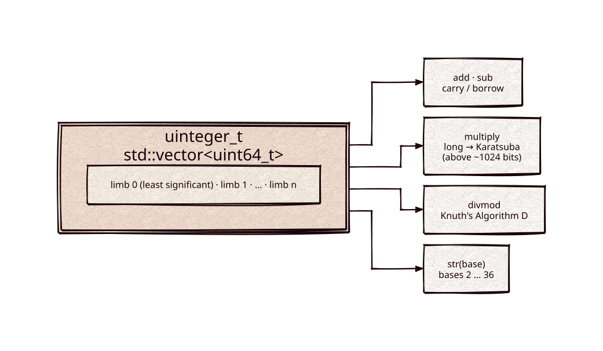

# uinteger_t

[](https://github.com/Kronuz/uinteger_t/actions/workflows/ci.yml)
[](LICENSE)


An arbitrary-precision unsigned integer for C++17 that reads like a built-in
one: construct it from numbers or strings in any base from 2 to 36, do the
usual arithmetic, and print it in any base. For exact math past 64 bits.



## ✨ Highlights

- **Feels native.** `+ - * / %`, bitwise and shift operators, comparisons, and
  `std::cout << std::hex`.
- **Grows as needed.** Values are as wide as memory allows.
- **Tuned arithmetic.** 64-bit limbs with hardware carry where available,
  Karatsuba multiplication above about 1,024 bits, and Knuth's Algorithm D for
  division.
- **Any base.** Parse and render bases 2 to 36; `divmod` returns quotient and
  remainder in one call.
- **One header, no dependencies.** [base-x](https://github.com/Kronuz/base-x)
  builds its encoders on it.

## 📦 Installation

Requires a C++17 compiler; CMake 3.14 or newer for the CMake route. CI builds it
on Linux (x86_64, arm64), macOS (arm64, x86_64), and FreeBSD, plus ASan, UBSan,
and TSan builds.

```cmake
include(FetchContent)
FetchContent_Declare(uinteger_t
  GIT_REPOSITORY https://github.com/Kronuz/uinteger_t.git
  GIT_TAG        master)
FetchContent_MakeAvailable(uinteger_t)

target_link_libraries(my_app PRIVATE uinteger_t::uinteger_t)
```

Or copy `uinteger_t.hh` onto your include path.

## 🚀 Quick start

```cpp
#include "uinteger_t.hh"

#include <iostream>

int main() {
	uinteger_t a = 3735879680;
	uinteger_t b("beee", 16);                         // base as the second argument
	uinteger_t n = a + b + 1;
	std::cout << n << '\n';                           // 3735928559
	std::cout << std::hex << n << '\n';               // deadbeef

	uinteger_t two_64("18446744073709551616", 10);
	std::cout << std::dec << two_64 * two_64 << '\n'; // 2^128
}
```

[`examples/demo.cc`](examples/demo.cc) computes `40!`, round-trips bases, and uses
`divmod`.

## 🎯 When to use it

- ✅ Exact unsigned integers wider than 64 bits: big hashes, IDs, base
  conversion, factorials.
- ❌ Signed values, rationals, or modular-arithmetic primitives: it is unsigned
  only, and `small - large` wraps.
- ❌ A fixed width you already have: `uint64_t` or `unsigned __int128` is faster.

## 📚 Documentation

- [docs/API.md](docs/API.md): constructors, operators, conversions, rendering,
  and caveats.
- [ARCHITECTURE.md](ARCHITECTURE.md): the limb layout, the window views, and the
  arithmetic algorithms.
- [AGENTS.md](AGENTS.md): repository map and traps.

## 🛠️ Building and testing

```sh
cmake -B build && cmake --build build && ctest --test-dir build
./build/uinteger_t_demo
```

## 🤝 Contributing

Issues and pull requests are welcome. Read [AGENTS.md](AGENTS.md) first. CI must
pass on every platform.

## 📄 License

MIT, Copyright (c) 2017, 2019 Germán Méndez Bravo and (c) 2013-2017 Jason Lee,
whose `uint128_t` it grew from. See [LICENSE](LICENSE).
