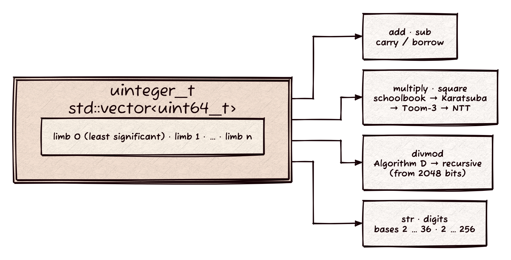

# uinteger_t

Part of [Kronuz C++ Libraries](https://github.com/Kronuz/cpp-libraries), a collection of small, reusable C++ libraries.

[](https://github.com/Kronuz/uinteger_t/actions/workflows/ci.yml)
[](LICENSE)


An arbitrary-precision unsigned integer for C++17 that reads like a built-in
one: construct it from numbers or strings in bases 2 to 36 (or raw bytes), do the
usual arithmetic, and print it in any of them. For exact math past 64 bits.



## ✨ Highlights

- **Feels native.** `+ - * / %`, bitwise and shift operators, comparisons, and
  `std::cout << std::hex`.
- **Grows as needed.** Values are as wide as memory allows.
- **Tuned arithmetic.** 64-bit limbs with hardware carry where available,
  Karatsuba, Toom-3, Toom-4 and number-theoretic transform multiplication with dedicated
  squaring, and division by Knuth's Algorithm D with reciprocal-based quotient
  estimates, recursive (Burnikel-Ziegler) from 2,048-bit divisors, and by an
  approximate reciprocal (Newton iteration) for divisors of 1,400 limbs and quotients of 5,000.
- **Any base.** Parse and render bases 2 to 36 and 256 (raw bytes); `digits()` and
  `from_digits()` convert to and from digit arrays in bases 2 to 256, which is how
  [base-x](https://github.com/Kronuz/base-x) maps its alphabets; `divmod` returns
  quotient and remainder in one call.
- **One header, no dependencies.** [base-x](https://github.com/Kronuz/base-x)
  builds its encoders on it.

## 📦 Installation

Requires a C++17 compiler; CMake 3.14 or newer for the CMake route. CI builds it
on Linux (x86_64, arm64), macOS (arm64, x86_64), and FreeBSD, plus ASan, UBSan,
and TSan builds.

```cmake
include(FetchContent)
FetchContent_Declare(uinteger_t
  GIT_REPOSITORY https://github.com/Kronuz/uinteger_t.git
  GIT_TAG        master)
FetchContent_MakeAvailable(uinteger_t)

target_link_libraries(my_app PRIVATE uinteger_t::uinteger_t)
```

Or copy `uinteger_t.hh` onto your include path.

## 🚀 Quick start

```cpp
#include "uinteger_t.hh"

#include <iostream>

int main() {
	uinteger_t a = 3735879680;
	uinteger_t b("beee", 16);                         // base as the second argument
	uinteger_t n = a + b + 1;
	std::cout << n << '\n';                           // 3735928559
	std::cout << std::hex << n << '\n';               // deadbeef

	uinteger_t two_64("18446744073709551616", 10);
	std::cout << std::dec << two_64 * two_64 << '\n'; // 2^128
}
```

[`examples/demo.cc`](examples/demo.cc) computes `40!`, round-trips bases, and uses
`divmod`.

## 🎯 When to use it

- ✅ Exact unsigned integers wider than 64 bits: big hashes, IDs, base
  conversion, factorials.
- ❌ Signed values, rationals, or modular-arithmetic primitives: it is unsigned
  only, and `small - large` wraps.
- ❌ A fixed width you already have: `uint64_t` or `unsigned __int128` is faster.
- ⚠️ A translation unit that prints or parses numbers costs the compiler about twice the work at -O2
  with the default conversion kernels as with `UINTEGER_T_RADIX_UNROLL=0` (see
  [ARCHITECTURE.md](ARCHITECTURE.md), Memory and compile cost).
- ⚠️ A value of up to 8 limbs (64 bytes) lives inside the object, so
  `sizeof(uinteger_t)` is 88 bytes at the defaults. The limb container's iterators
  are plain pointers (see [docs/API.md](docs/API.md), Limb storage).

## ⚡ Performance

Microseconds per call on an Apple M1 Pro (Apple clang 21, `-O2`) for random operands, against
GMP 6.3.0 and Boost.Multiprecision 1.92's `cpp_int`; the best of two runs of
[`bench/bench.cc`](bench/bench.cc). GMP writes each result into an existing `mpz_t`, while
uinteger_t's operators and Boost's return a new value (uinteger_t allocates one above 512 bits);
`uinteger_t::mul` and `uinteger_t::divmod` write into existing values instead.

| operation | bits | uinteger_t | GMP | Boost `cpp_int` |
|---|---:|---:|---:|---:|
| `a + b` | 256 | 0.007 | 0.004 | 0.026 |
|  | 4,096 | 0.058 | 0.017 | 0.088 |
|  | 65,536 | 0.479 | 0.317 | 1.06 |
|  | 1,048,576 | 7.25 | 5.12 | 21.5 |
| `a * b` | 256 | 0.021 | 0.015 | 0.046 |
|  | 4,096 | 1.61 | 1.19 | 3.00 |
|  | 65,536 | 123 | 80.0 | 283 |
|  | 1,048,576 | 2,818 | 2,120 | 23,571 |
| `a / b`, b half of a | 256 | 0.032 | 0.026 | 0.093 |
|  | 4,096 | 1.02 | 0.499 | 3.39 |
|  | 65,536 | 92.9 | 51.9 | 830 |
|  | 1,048,576 | 4,653 | 2,062 | 210,137 |
| `a.str(10)` | 256 | 0.102 | 0.135 | 0.310 |
|  | 4,096 | 2.83 | 4.05 | 33.5 |
|  | 65,536 | 291 | 207 | 9,544 |
|  | 1,048,576 | 20,765 | 11,117 | 2,455,933 |
| `uinteger_t(s, 10)` | 256 | 0.138 | 0.106 | 0.109 |
|  | 4,096 | 3.08 | 1.97 | 2.78 |
|  | 65,536 | 177 | 102 | 372 |
|  | 1,048,576 | 8,994 | 4,920 | 90,578 |

Decimal printing is faster than GMP's up to 4,096 bits. Elsewhere uinteger_t takes 1.2 to 2.3
times GMP's time, and a new 4,096-bit sum 3.4 times, where allocating the result costs more
than the addition. Boost takes 2 to 4 times uinteger_t's time at 256 bits and 3 (sums) to 118
(decimal printing) times at a million bits, but parses decimal faster up to 4,096 bits. An Intel
Core i9-9980HK (Apple clang 17) shows the same pattern.

## 📚 Documentation

- [docs/API.md](docs/API.md): constructors, operators, conversions, rendering,
  and caveats.
- [ARCHITECTURE.md](ARCHITECTURE.md): the limb layout and the
  arithmetic algorithms.
- [CHANGELOG.md](CHANGELOG.md): what changed, by date.
- [AGENTS.md](AGENTS.md): repository map and traps.

## 🛠️ Building and testing

```sh
cmake -B build && cmake --build build && ctest --test-dir build
./build/uinteger_t_demo
```

## 🤝 Contributing

Issues and pull requests are welcome. Read [AGENTS.md](AGENTS.md) first. CI must
pass on every platform.

## 📄 License

MIT, Copyright (c) 2017-2026 Germán Méndez Bravo and (c) 2013-2017 Jason Lee,
whose `uint128_t` it grew from. See [LICENSE](LICENSE).
